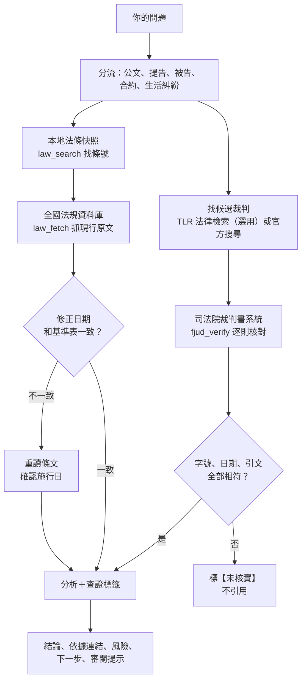

# tw-legal：台灣法務助手

讓 Claude 用律師的查證方法處理台灣的法律問題：條文和裁判一律回官方原文核對，查不到就說查不到。個人與需要自救的人都能免費使用；公司使用請先來信取得同意。

[](https://creativecommons.org/licenses/by-nc-nd/4.0/deed.zh-hant)


> ⚠️ **重要提醒**
> **這不是律師，也不是法律意見。**個人自救與教育都能免費使用；**公司使用請先來信取得同意，不得用來對外收費提供法律服務**。
> 不變期間快到、金額或刑責重大時，請找律師或法律扶助基金會（全國專線 412-8518）。
> 使用前請讀[免責聲明](DISCLAIMER.md)。

**目錄**：[為什麼需要它](#為什麼需要它)｜[重點](#重點)｜[雙重校正](#雙重校正怎麼運作)｜[官方來源](#自動比對的官方來源)｜[濃縮了什麼](#濃縮了哪些方法與技術)｜[設計取捨](#設計取捨)｜[涵蓋範圍](#涵蓋範圍)｜[安裝](#安裝)｜[使用範例](#使用範例)｜[驗證結果](#驗證結果)｜[授權](#授權與使用範圍)｜[作者與合作](#作者與合作)

## 為什麼需要它

- **讓不懂法律的人少吃虧。**很多人不是沒理，而是不知道期限、不知道自己有什麼權利、請不起律師，最後只能吃虧。tw-legal 想讓個人與需要自救的人，至少有一個免費的第一步：先弄懂問題、整理證據、算出期限，再決定要不要找律師或法扶。
- **請不起律師也有路。**可以向法律扶助基金會申請扶助；付不出訴訟費用的，可以向法院聲請訴訟救助（民事訴訟法第 107 條）。tw-legal 會提醒你什麼時候該走這兩條路。
- **AI 最危險的錯，是看起來很對的捏造。**判決字號格式完全正確，但那則判決根本不存在。2023 年美國 Mata v. Avianca 案，律師引用 ChatGPT 編出的判決，律師和事務所都被法院制裁。
- **一般人遇到法律問題，最常卡在三件事：**不知道期限到哪天、不知道去哪裡查、分不出網路上的說法是不是真的。
- **tw-legal 把「先查證、再分析、最後給建議」變成固定流程。**每次回答都走一遍，並標出每句話的來源。

tw-legal 是給 Claude 用的技能包（skill）：一組工作指示加上查證工具。裝好之後，你問到台灣法律問題，Claude 會自動載入並照著做。

## 重點

| 特色 | 做法 |
|---|---|
| 雙重校正 | 先用檢索找候選，再到官方系統逐字核對；全部相符才引用 |
| 律師工作方法 | 程序先行（管轄、期限、當事人、費用、是否必須委任律師），再拆要件、對證據 |
| 查證標籤 | 每個重要陳述都標來源，例如【官方原文】【裁判原文】【文件】【推論】【未核實】，共 9 種 |
| 期限優先 | 常用不變期間表，加上送達與在途期間的算法，算出「最晚哪一天」 |
| 書狀與證物品管 | PDF 自動檢查紙張、邊界、字級、頁碼與必含或禁止的字詞；截圖分格放大、逐字讀兩次，看不清就標〔?〕 |
| 合約審查 | 五步流程加上紅黃綠分級，每條依據都附全國法規資料庫連結 |
| 隱私 | 查詢不放個資；弱點、策略等內部分析，不會放進要寄給法院或對方的檔案 |

## 雙重校正怎麼運作



**法條**
1. `law_search.py` 在本地的 12 部法規全文快照裡，用關鍵字找條號。
2. `law_fetch.py` 到全國法規資料庫抓現行原文與修正日期。
3. 修正日期和基準表不同，代表修過法：重讀條文，並確認施行日。

**裁判**
1. 找候選：用 TLR 法律偵探的檢索增強生成（RAG：先搜尋資料，再根據找到的內容回答），或在司法院系統搜尋。
2. `fjud_verify.js` 在司法院裁判書系統打開原文，逐則核對法院、字號、日期，並確認要引用的句子真的在原文裡。
3. 全部相符才標【裁判原文】；有一項不符就標【未核實】，不引用。

> **分工原則：檢索負責找，官方原文負責證。**實測時，檢索服務的字號查詢有漏收、審級關聯有連錯（紀錄見 `references/07`），所以它的結果只當線索。

## 自動比對的官方來源

| 來源 | 用途 | 方式 |
|---|---|---|
| [全國法規資料庫](https://law.moj.gov.tw/) | 現行條文、修正日期、法規代碼 | 腳本自動抓取 |
| [司法院裁判書系統](https://judgment.judicial.gov.tw/FJUD/default.aspx) | 裁判原文 | 在瀏覽器內批次核對 |
| [司法院法學資料檢索系統](https://lawsearch.judicial.gov.tw/default.aspx) | 判解函釋、大法庭 | 指引查詢 |
| [法務部主管法規查詢系統](https://mojlaw.moj.gov.tw/) | 法務部函釋 | 指引查詢 |
| [憲法法庭](https://cons.judicial.gov.tw/) | 判決、裁定 | 指引查詢 |
| 司法院開庭進度、庭期表、案件進度查詢 | 辨別公文真偽、追蹤案件 | 指引查詢 |
| [法律扶助基金會](https://www.laf.org.tw/) | 轉介專業協助 | 指引 |
| TLR 法律偵探（第三方，選用） | 相似裁判與函釋的語義檢索 | MCP 連接器（讓 Claude 連接外部工具的標準介面） |

「指引查詢」是技能包告訴 Claude 或你該去哪裡查，不會自動抓取。

## 濃縮了哪些方法與技術

**法律工作方法**
- 八步流程：分流 → 盤點事實與文件 → 程序先行 → 爭點與法律依據 → 查實務 → 策略 → 撰寫或覆核 → 交付
- 六條底線：不捏造、用現行條文、裁判先開原文、圖片逐字精讀、事實分級、不保證結果
- 判斷違法或合法：刑事、行政、民事三種責任分開看，結論分三級並附條文
- 判決裡「原告主張」「被告則以」是當事人的說法，不當成法院見解

**參考的開源專案**（Apache-2.0，改寫的地方都有註明）
- Anthropic [claude-for-legal](https://github.com/anthropics/claude-for-legal)：審閱提示、引用紀律、「這樣有問題嗎」陷阱檢查，改寫成台灣版
- [tern/taiwan-claude-legal](https://github.com/tern/taiwan-claude-legal)：合約審查五步流程、可點連結的條文引用、法條快照的做法

**檢索用法**（搭配 TLR 法律偵探）
- 片語搜尋法院的固定寫法、語義搜尋看算法分布、反方查詢找對方會怎麼抗辯、追被引用的最高法院字號
- 查詢不放個資，也不放自己的案號

**工程**
- 只用 Python 標準函式庫抓取與解析官方網頁，驗證 HTTPS 憑證，保留「項」「款」分行
- 重建法條快照時比對條數，不一致就拒絕寫入
- 裁判批次核對：先去掉檢索摘要裡插入的標記，再逐字比對
- PDF 檢查（PyMuPDF）、圖片分格放大（Pillow）

## 設計取捨

| 問題 | 做法 | 原因 |
|---|---|---|
| 檢索服務會漏收、連錯 | 檢索只找候選，引用一律回官方原文核對 | 「找得快」和「引得準」是兩件事，分開處理 |
| 法條要好找，又要是現行版本 | 本地快照負責搜尋，即時抓取負責引用，再比對修正日期 | 快照可以離線搜尋；即時抓取確保沒有過期 |
| 第三方套件有供應鏈風險 | 抓取與解析只用 Python 標準函式庫，並驗證 HTTPS 憑證 | 少一個套件，就少一個出錯或被竄改的地方 |
| 司法院網站擋程式直接下載 | 在瀏覽器頁面內逐則查詢，不大量抓取 | 用正常瀏覽的方式核對，不造成網站負擔 |
| AI 容易把推論寫成事實 | 每個重要陳述都標來源類別 | 讀的人一眼看出哪些是原文、哪些是推論 |

## 涵蓋範圍

| 情境 | 例子 | 參考檔 |
|---|---|---|
| 收到法院或檢察署公文 | 辨真偽、算到期日、決定第一步 | SKILL.md |
| 民事與強制執行 | 本票裁定、債務人異議之訴、停止執行與擔保、扣薪、時效、利息 | 03、06 |
| 刑事程序 | 告訴、不起訴與再議、自訴、附帶民事 | 04 |
| 行政救濟 | 罰鍰、訴願、交通違規裁決 | 09 |
| 生活糾紛 | 車禍、勞資、網購七天解除、詐騙 | 09 |
| 合約審查 | 保密協議、勞動契約、競業禁止、最低服務年限、股東協議、隱私權政策 | 10 |
| 書狀與證物 | 撰寫與覆核、截圖當證據、PDF 定稿檢查 | 05 |

法條快照（2026-10-29）：民法、公司法、勞動基準法、個人資料保護法、著作權法、民事訴訟法、強制執行法、非訟事件法、票據法、中華民國刑法、刑事訴訟法、消費者保護法。

## 安裝

**需求**
- Claude Code（Anthropic 的 AI 助手，有桌面版與終端機版）
- Python 3（作者在 Windows 11、Python 3.14 測試）
- 選用：`pip install pymupdf pillow`，用於 PDF 檢查與圖片放大
- 選用：Claude 桌面版的內建瀏覽器或 Claude in Chrome，用於裁判核對
- 選用：TLR 法律偵探連接器

**方法一：外掛安裝（一行指令）**

```bash
claude plugin marketplace add a65041230/tw-legal-skill
claude plugin install tw-legal@tw-legal-skill
```

**方法二：手動**

下載本專案，把 `skills/tw-legal` 整個資料夾放到 `~/.claude/skills/`（Windows 是 `C:\Users\你的帳號\.claude\skills\`），再重新開啟 Claude Code。

**用其他 AI 助手（例如 Codex）**

見 [AGENTS.md](AGENTS.md)：安裝位置，以及和 Claude 版不同的地方。

**選用：接 TLR 法律偵探**

在 Claude 桌面版：Customize → Connectors → Add custom connector，網址填 `https://tlr.dr-legal.com.tw/mcp`，再依畫面完成授權。接上就表示你同意它的服務條款，請先自行閱讀。

## 使用範例

直接用平常的話問，不用記指令：

- 「交通罰單的裁決我不服，要怎麼救濟？」
- 「幫我看這份勞動契約，競業禁止和違約金合理嗎？」
- 「房東不退押金，我可以怎麼處理？」
- 「我收到法院的裁定，要怎麼處理？期限到哪天？」

回覆格式示意（節錄，不是實際執行紀錄）：

> **結論：**不服交通違規的裁決，直接向高等行政法院地方行政訴訟庭起訴，不用先訴願。撤銷訴訟最晚要在裁決書送達後 30 日內提起，這是不變期間。
>
> **依據：**[道路交通管理處罰條例第 87 條](https://law.moj.gov.tw/LawClass/LawSingle.aspx?pcode=K0040012&flno=87)、[行政訴訟法第 237-3 條](https://law.moj.gov.tw/LawClass/LawSingle.aspx?pcode=A0030154&flno=237-3)【官方原文，查詢日 2026-10-29】
>
> **下一步：**找出裁決書的送達日期，算出最後一天，寫進期限表。
>
> **審閱提示：**2 條條文已核對現行版本；送達日期待你確認。

## 驗證結果

| 項目 | 結果 | 日期 |
|---|---|---|
| 技能包引用的條文都存在，項、款正確 | 通過：171 組 | 2026-10-29 |
| 基準表法規的修正日期與官方一致 | 通過：32 部 | 2026-10-29 |
| 引用的裁判在司法院裁判書系統查得到 | 通過：17 則 | 2026-10-29 |
| 法條快照與上游專案內容一致 | 通過：5 部共 2,295 條 | 2026-10-29 |
| 法條快照與即時抓取逐行一致 | 通過：抽查 26 條 | 2026-10-29 |
| 外掛與技能包格式（`claude plugin validate --strict`） | 通過 | 2026-10-29 |
| 自動觸發效果 | 尚未測試 | — |
| 用外掛指令實際安裝 | 尚未測試 | — |
| macOS、Linux、claude.ai 上傳 | 尚未測試 | — |

## 限制

- 不是律師，不能出庭、簽名或遞狀；寄出、繳費、和解都由你自己決定。
- 法條快照只有 12 部，其他法規靠即時抓取。
- 司法院裁判書系統會擋程式直接下載，裁判核對需要瀏覽器工具。
- TLR 是第三方免費服務，可能限速或暫停，結果只當線索。
- 條文基準日是 2026-10-28；2027-04-28 以後使用，要先重跑基準表。

## 隱私

- 本專案只收錄一般法律知識與公開裁判，不含任何個案資料；每次發布前都會掃描檔名與內容。
- `law_fetch.py` 只把法規名稱、法規代碼與條號送到全國法規資料庫；`fjud_verify.js` 只把裁判字號送到司法院。
- 你和 Claude 的對話，依你使用的 AI 服務的條款處理。
- 回報問題時，請不要在 GitHub Issues 貼姓名、身分證字號、帳號或案號。

## 授權與使用範圍

| 內容 | 授權 |
|---|---|
| SKILL.md、references/ 與說明文件 | [CC BY-NC-ND 4.0](https://creativecommons.org/licenses/by-nc-nd/4.0/deed.zh-hant)（姓名標示─非商業性─禁止改作） |
| scripts/ | MIT：通用工具（抓法條、檢查 PDF），不含法律知識，可以自由使用 |
| laws/ 的法條原文 | 法律不得為著作權之標的（著作權法第 9 條），本專案不主張權利 |
| 改寫自 Apache-2.0 專案的部分 | 見 [THIRD_PARTY_NOTICES.md](THIRD_PARTY_NOTICES.md) |

**公司使用：**公司、機關與團體要使用本專案（包括只在內部使用），請先寄信到 [a65041230@gmail.com](mailto:a65041230@gmail.com) 說明用途，取得作者書面同意後才能使用。作者可以免費同意；但用本專案對外提供收費的法律服務或產品，一律不同意。

姓名標示請寫：沈慶隆（Ken Shen），tw-legal。

**可以**
- 個人遇到法律問題時，自己查、自己準備
- 公司、店家、機關：先來信取得作者書面同意，再於內部使用
- 免費幫家人、朋友查詢
- 學校教學、學生自學、學術研究
- 非營利團體免費協助民眾
- 為了自己使用而修改（修改後的版本不能分享）

**不可以**
- 公司、機關、團體未經作者書面同意就使用
- 律師事務所、法律工作室、代書、顧問公司等，用來對外提供法律服務營利
- 收費代寫書狀、收費法律諮詢
- 包裝成付費的產品、課程或服務
- 分享或公開修改過的版本
- 移除或變更各檔案開頭的權利資訊

## 官方版本與驗證

- **官方版本只在這裡：**https://github.com/a65041230/tw-legal-skill。在其他地方看到修改版、收費版，或自稱經作者授權的版本，請來信告知。
- **權利資訊：**每個檔案開頭都有「tw-legal 權利資訊」，寫明著作人、授權、官方來源與識別碼 `TWL-KS-20261029`。這屬於著作權法所稱的「權利管理電子資訊」（著作權法第 3 條第 1 項第 17 款），不得移除或變更（第 80 條之 1）；違反的，依第 96 條之 1 處一年以下有期徒刑、拘役，或科或併科新臺幣二萬元以上二十五萬元以下罰金。這是公開、可見的標示，不使用隱藏浮水印。
- **改作：**你可以為了自己使用而修改，但不能把改過的版本分享出去。這是 CC BY-NC-ND 4.0 授權條文本身的規定。
- **確認檔案沒被改過：**在專案資料夾執行 `sha256sum -c MANIFEST.sha256`（Windows 可用 Git Bash），每一行都是 OK 才是官方原版。

## 致謝

- Anthropic claude-for-legal、tern/taiwan-claude-legal
- 全國法規資料庫、司法院裁判書系統
- [TLR 法律偵探](https://tlr.dr-legal.com.tw)（原始碼：[aa0101181514/tw-legal-rag](https://github.com/aa0101181514/tw-legal-rag)）：本專案只說明如何連接它的服務，不含其程式或資料

## 回報錯誤

發現條文、字號或期限有錯，請到 GitHub Issues 回報，並附上官方原文連結，這類錯誤優先處理。

## 作者與合作

**沈慶隆（Ken Shen）**，以 Claude Code 協作開發。

如果你有研究需求，或想討論其他合作的可能，歡迎來信：[a65041230@gmail.com](mailto:a65041230@gmail.com)

> 我不是律師，無法回覆個案的法律問題。個案請洽律師或法律扶助基金會（全國專線 412-8518）。
